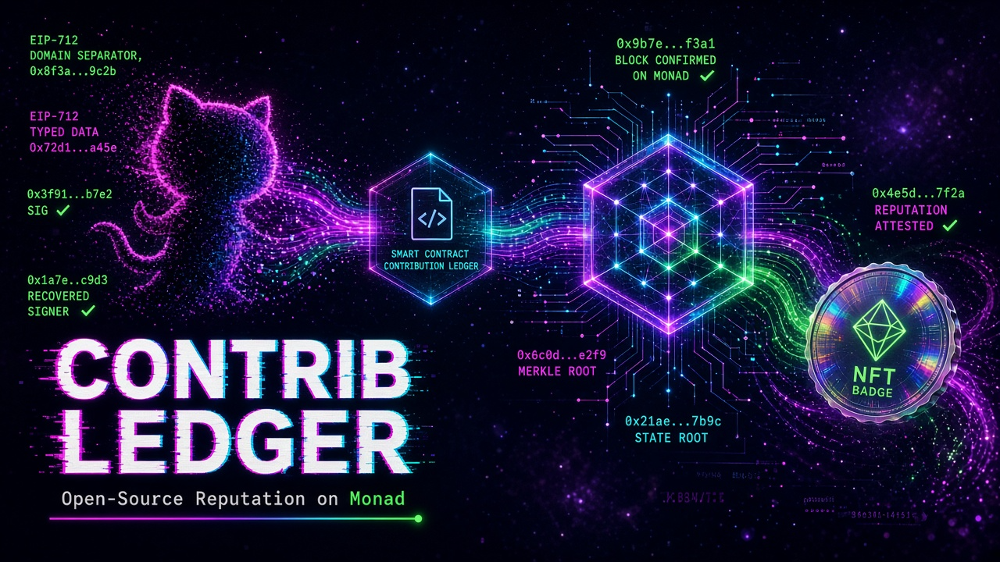

# Contrib Ledger



开源贡献的「估值 → 维护者签名 → 贡献者自己上链」demo，部署在 Monad 测试网。

维护者在链下给已合并的 PR 打分并做 EIP-712 签名；贡献者用自己的钱包把签名提交到 `ContributionRegistry`。合约验签通过后记账、累加积分，并 mint 一枚声誉 NFT。积分不是可转让代币。

仓库：https://github.com/iis-MarkKuang/contrib-ledger

---

## 一句话流程

```text
GitHub PR 合并
  → server    链下估值 + EIP-712 签名（私钥只在这里）
  → web       贡献者用 MetaMask 发交易
  → ContributionRegistry @ Monad testnet
  → web       读事件，显示积分和声誉 NFT
```

细节和时序图见 [SOLUTION.md](SOLUTION.md)，需求文档在 `requirements/`。

---

## 现在有什么

合约、链下签名和 webhook 已能在本地跑通。页面能连 MetaMask，在 Monad 测试网和本地 Anvil 之间切换，并读出贡献、积分和声誉 NFT。进度记在 [progress/](progress/)，下一张票见 [ROADMAP.md](ROADMAP.md)。

| 模块 | 状态 |
| --- | --- |
| `contracts/` | `ContributionRegistry`：EIP-712 验签、积分、声誉 NFT。`forge test` 通过 |
| `server/` | 健康检查、估值、EIP-712 签名、`POST /webhook` |
| `web/` | 连接 MetaMask，选择网络，看板读链 |
| `SOLUTION.md` | 架构、依赖、时序图 |

**不做的事**：DAO、预言机、跨链、可交易代币、contract.dev、嵌入式钱包。社区挑战先搁置。

---

## 本地运行

前置：Foundry ≥ 1.8，`forge` 在 `PATH` 里。

**1. 配置环境变量**

```bash
cp .env.example .env   # 变量名见 .env.example，.env 不要提交
```

**2. 启动后端**

```bash
cd server && npm install && npm run dev
```

健康检查：`curl http://127.0.0.1:8787/health`

**3. 启动前端**

```bash
cd web && npm install && npm run dev
```

**4. 跑合约测试 / 本地链**

```bash
cd contracts
forge test --network monad
anvil --network monad
```

`foundry.toml` 已写 `network = "monad"`。本地链是空的 Anvil，不 fork 测试网。签名 chain id 默认是测试网 `10143`；Anvil 测试单独用 `31337`。

---

## 链参数

以 [docs/monad-testnet.md](docs/monad-testnet.md) 为准：

| 项 | 测试网 | 本地 Anvil |
| --- | --- | --- |
| Chain ID | `10143` | `31337` |
| RPC | `https://testnet-rpc.monad.xyz`（公开，无需 key） | `http://127.0.0.1:8545` |
| 浏览器 | `https://testnet.monadscan.com` | — |
