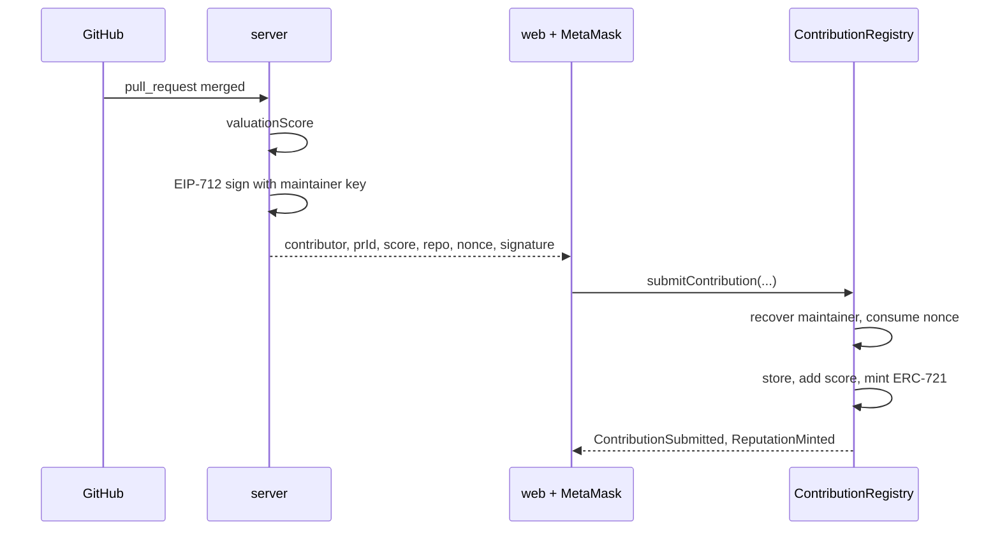
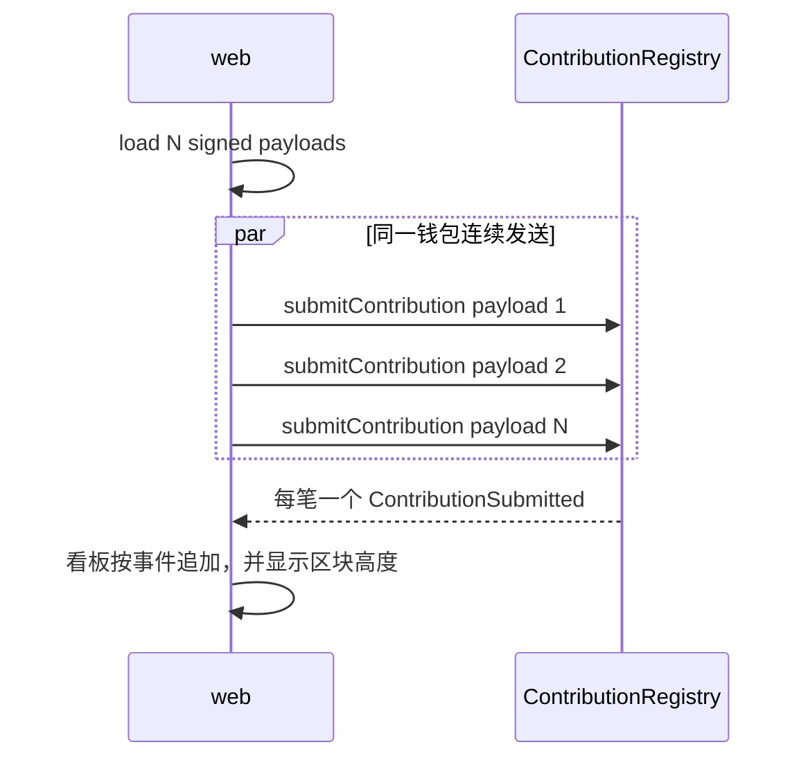

# Solution

对应需求：`requirements/开源贡献激励-Monad测试网Demo需求文档.md` v2.0。实现前如果要偏离本文，先改本文再改票。

## 架构

一个合约 `ContributionRegistry`，继承 OpenZeppelin `ERC721` 和 `EIP712`。维护者私钥只留在链下，用来签估值。贡献者用自己的钱包提交交易并付 gas。合约 `ecrecover` 出维护者地址后才记账并 mint。

```text
GitHub
  │ pull_request merged / issues closed
  ▼
server (TypeScript)          私钥只在这里
  估值 → EIP-712 签名 → 待提交 JSON
  ▼
web (React + ethers)         MetaMask 签名交易，不是签名估值
  ▼
ContributionRegistry         Monad 测试网
  验签、记账、累加积分、mint ERC-721
  ▼
web 读事件，刷新看板
```

本地开发用 `anvil --network monad`，不 fork 测试网。演示部署到 Monad 测试网。见 [docs/monad-fork.md](docs/monad-fork.md)。

## 依赖

| 库 | 用在 | 不用它来做 |
| --- | --- | --- |
| Foundry ≥ 1.8，`network = "monad"` | 编译、测试、脚本、本地链 | 不换 Hardhat，除非用户改口 |
| forge-std | Forge 测试 | |
| OpenZeppelin Contracts 5（`ERC721`、`EIP712`、`ECDSA`、`Ownable`） | NFT、类型哈希、地址恢复、`setMaintainer` | 不引入治理、代币 |
| Node.js + TypeScript | `server/`、`web/` | |
| express | GitHub webhook | |
| ethers v6 | 链下签名、前端发交易、读事件 | 不另加 viem / wagmi |
| React + Vite | 看板 | 不换 Next.js |

不安装：`@contract-dev/cli`、Hardhat、Envio、Para、Alchemy CLI、链上预言机 SDK。

## 合约要点

EIP-712 类型，链上链下必须同一串：

```text
Contribution(address contributor,uint256 prOrIssueId,uint256 valuationScore,string repo,uint256 nonce)
```

- `nonce` 全局一次性。同一 `(repo, prOrIssueId)` 不能记两次。
- `contributor` 来自签名载荷，不要求等于 `msg.sender`。演示可以用一个钱包替多条预置记录发交易。
- 验签过才写存储并 mint。mint 失败则整笔回滚。
- 积分是 `uint256` 累加，不是可转让代币。

## 单条闭环



## 并发演示

预置签名在演示前生成，按钮只负责发出多笔独立交易。每笔写不同的 nonce 和 prId，存储槽不冲突。



N 用 50。不够讲清楚再加，不超过 100，避免打满公共 RPC。

## 红线

写在每张票的约束里，这里是总表：

- 维护者私钥、带密钥的 RPC，不进仓库、日志、聊天。
- 不接 DAO、预言机、跨链、可交易代币、contract.dev。
- 地址和 gas 以 `docs/monad-testnet.md` 和对应 skill 为准，冲突就停。
- 社区挑战（需求 C）不在下面的实现票里。
